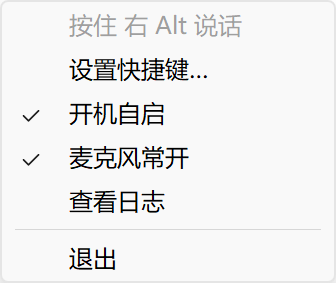
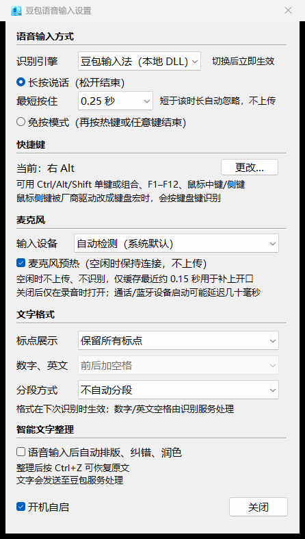

# 豆包语音输入（独立版）

把豆包输入法里的语音转文字能力单独抽出来的 Windows 小工具：按住快捷键说话，松开后文字直接输入到当前光标处，不用切换输入法；也可以切换成按一次开始、再按一次结束的免按模式。

## 功能

- 长按说话、松开输入，`Esc` 取消；轻点一下会自动忽略，不会上传识别；也支持免按模式（按一次开始，再按热键、任意键或鼠标键结束）
- 实时转录浮层，边说边看
- 默认快捷键 `右 Alt`，可改成组合键、单功能键或鼠标中键/侧键
- 图形设置窗口：输入方式、快捷键、麦克风、文字格式、开机自启集中配置
- 麦克风可选自动检测或指定设备
- 文字格式可调：标点展示、汉字与数字/英文之间是否加空格、按句末标点自动分段
- 智能文字整理（完整版）：识别结果先照常输入，再自动排版、纠错、润色；按 `Ctrl+Z` 可恢复原文
- 输入结果校验：文字没进输入框时自动复制到剪贴板，不会丢
- 麦克风策略可切换：麦克风预热（默认，空闲时保持连接，延迟最低），或仅在录音时打开、结束即关闭（系统麦克风指示器只在录音时亮）
- 托盘图标与菜单：设置、设置快捷键、开机自启、麦克风预热、查看日志、退出
- 单实例运行，重复启动会提示
- 无控制台窗口，开机自启不打扰
- 绿色单文件，无需安装

提供两个版本，功能相同，区别只在智能文字整理：

| 文件 | 大小 | 智能文字整理 | 依赖 |
| --- | --- | --- | --- |
| `DoubaoVoice.exe` | 约 29 MB | 支持 | 无需安装豆包输入法，运行时已内置 |
| `DoubaoVoice_Lite.exe` | 约 12.7 MB | 无 | 无 |

两个版本都会随 Release 发布。完整版包含豆包运行时文件，仅限本仓库内使用，请勿外传。

## 界面

按住快捷键说话时，屏幕底部浮层实时显示识别文字：


松开按键后等待最终结果：


输入成功：


注入失败时自动把文字放进剪贴板：


托盘右键菜单：



## 使用

1. 从 [Releases](../../releases) 下载 `DoubaoVoice.exe`（完整版）或 `DoubaoVoice_Lite.exe`（精简版）
2. 双击运行，出现托盘图标即已就绪
3. 在任意输入框里按住 `右 Alt`（或你设置的快捷键）说话，松开后自动输入；按 `Esc` 取消本次录音
4. 右击托盘图标选择“设置…”可集中调整输入方式、快捷键、麦克风与文字格式；托盘菜单也可快速切换快捷键、开机自启、麦克风预热或退出

## 设置

右击托盘图标选择“设置…”，或在启动时加 `--settings`：



- **语音输入方式**：长按说话（默认）或免按模式。长按模式下可设置**最短按住**（默认 0.25 秒）：按住时间短于该值时视为误触，直接忽略，不上传也不识别；设为“不限制”则保留旧行为。免按模式按一次热键开始录音，再按同一热键、任意字母/数字键、空格/回车或鼠标键结束；单按 Ctrl/Alt/Shift 不会结束；录音中按 `Esc` 取消。
- **快捷键**：点“更改…”后按下新组合键，必须包含 Ctrl/Alt/Shift，或使用 F1–F12；鼠标中键、侧键（后退/前进）可以单独使用，也可以搭配 Ctrl/Alt/Shift。若侧键被厂商驱动改成了键盘宏，会按键盘键识别。
- **麦克风**：输入设备可自动检测（系统默认）或指定，列表只包含 MME / DirectSound 设备。**麦克风预热**默认开启：空闲时保持音频流，不上传也不识别，只缓存最近约 0.15 秒用于补上开口瞬间，延迟最低；关闭后只在录音期间打开，系统麦克风指示器随之熄灭，代价是通话/蓝牙设备启动时可能多几十毫秒。
- **文字格式**（下次识别时生效）：
  - 标点展示：保留所有标点 / 句末不加标点 / 空格代替标点
  - 数字、英文：汉字与数字/英文之间是否留空格，由识别服务处理
  - 分段方式：不自动分段（默认）/ 分段后空行 / 分段不空行。程序按识别文本中的句末标点（。！？；等）切段；如果整段只有末尾一个标点，就不会产生多个分段。
- **智能文字整理**（仅完整版，默认关闭）：语音输入完成后，把识别结果交给豆包服务做排版、纠错、润色，再用整理后的文字替换刚输入的内容。整理后按 `Ctrl+Z` 可恢复原文。仅在文字确实发生变化时才替换；替换前会确认仍停留在原来的输入框，用户中途按键、点鼠标或切换窗口都会放弃替换。精简版没有这一项。
- **开机自启**：写入当前用户的启动项。

设置保存在 exe 同目录的 `config.json`，对应字段：`voice_mode`（`hold` / `hands_free`）、`min_hold_ms`（`0` / `150` / `250` / `400`）、`hotkey`、`mic_device`、`mic_mode`（`always` / `press`）、`punctuation_mode`（`keep_all` / `remove_trailing` / `space_replace`）、`zh_space`、`paragraph_mode`（`none` / `blank` / `single`）、`smart_text`。

麦克风默认预热，Windows 的麦克风使用指示器会一直亮着。它不会在空闲时上传或识别，按下快捷键后才开始录音，并补上开口前的约 0.15 秒缓存。不需要常亮指示器时可在设置中取消“麦克风预热”，之后只在录音期间打开麦克风，松开就关闭，指示器随之熄灭；代价是每次按下要花几十毫秒打开设备（蓝牙耳麦更久），开口的第一瞬间可能漏掉一点。

语音识别在豆包服务器完成，需要联网。如果听不到声音，检查“设置 → 隐私 → 麦克风”是否允许桌面应用访问麦克风。

开启“智能文字整理”后，识别出的文字还会发送到豆包服务做二次处理。完整版内置了所需运行时（`smart_runtime.zip`，解压后约 55 MB）：启动时先解出语音引擎需要的两个 DLL，首次开启智能文字整理时再把其余文件解压到同一目录 `%LOCALAPPDATA%\DoubaoVoice\runtime\<版本>` 并调用其中的命令行接口；程序不会修改系统里已安装的豆包输入法，也不会在未开启该功能时调用它。精简版不包含这部分代码和运行时，也不会把文字发送去做二次处理。

## 构建

环境：Windows x64、Python 3.11。

```bat
pip install -r requirements.txt

:: 完整版（内置智能文字整理运行时）
set DOUBAO_VARIANT=full
python -m PyInstaller --noconfirm --clean DoubaoVoice_new.spec

:: 精简版（无智能文字整理）
set DOUBAO_VARIANT=lite
python -m PyInstaller --noconfirm --clean DoubaoVoice_new.spec
```

产物为 `dist\DoubaoVoice.exe` 和 `dist\DoubaoVoice_Lite.exe`。`app/smart_runtime.zip` 与 `app/smart_runtime.version` 由 `tools/pack_smart_runtime.py` 从本机已安装的豆包输入法生成，已提交在仓库里，正常构建不需要重新生成。推送 `v*` 标签时 GitHub Actions 会构建并发布两个版本的 Release。

## 命令行参数

程序是无控制台的 GUI 程序，参数只在本次启动生效，屏幕上不会有文字输出；识别结果显示在悬浮窗，详细信息写入 exe 同目录的 `voice_ime.log`。

| 参数 | 说明 |
| --- | --- |
| `--device N` | 指定麦克风设备编号，默认用系统默认设备 |
| `--wav FILE` | 用 wav 文件代替麦克风（需 16kHz、单声道、16bit） |
| `--once` | 启动后立即识别一次并退出，必须配合 `--wav` |
| `--inject unicode\|paste` | 文字注入方式：逐字模拟键盘（默认）/ 剪贴板粘贴 |
| `--no-inject` | 只识别不输入 |
| `--no-ui` | 不显示悬浮提示 |
| `--no-tray` | 不显示托盘图标（日常不建议，退出只能靠任务管理器） |
| `--settings` | 启动时打开设置窗口 |
| `--verbose` | 日志记录每个中间识别结果 |

常用示例，在 exe 所在目录执行：

```bat
:: 测试识别：不碰麦克风、不注入，结果看日志
.\DoubaoVoice.exe --once --wav "D:\doubao_work\asr16k.wav" --no-inject --no-ui --no-tray --verbose

:: 指定第 2 个麦克风
.\DoubaoVoice.exe --device 2

:: 某些软件收不到模拟输入时，改用剪贴板粘贴
.\DoubaoVoice.exe --inject paste

:: 只识别不输入，悬浮窗显示识别结果
.\DoubaoVoice.exe --no-inject
```

补充说明：

- 设备编号可以用 `python -c "import sounddevice as sd; print(sd.query_devices())"` 查看，输出每行开头的数字就是编号；启动后日志也会打印实际使用的设备名。
- 带 `--wav` 的测试会跳过单实例检查，正常程序开着也能同时运行。
- 注入失败时（无论哪种注入方式）文字都会自动复制到剪贴板，不会丢。
- 开机自启固定以无参数方式启动。想固定使用某个参数，需要在 `HKCU\Software\Microsoft\Windows\CurrentVersion\Run` 里手动给命令追加参数，或做一个带参数的快捷方式。
- PowerShell 启动 GUI 程序不会等待结束；需要等待时可使用 `Start-Process -FilePath .\DoubaoVoice.exe -ArgumentList '...' -Wait`，Git Bash 中直接运行会等待。

## 目录结构

```
app/voice_ime.py        主程序（键盘/鼠标钩子、录音、ASR、文字注入、设置窗口、托盘、开机自启）
app/dll/                豆包 SAMI Core SDK
app/icon.ico            程序与托盘图标
app/smart_runtime.zip   智能文字整理运行时（压缩包，仅完整版打包）
app/smart_runtime.version  运行时版本号
DoubaoVoice_new.spec    PyInstaller 打包配置（DOUBAO_VARIANT=full/lite）
tools/                  逆向分析辅助脚本、运行时打包脚本
```

运行日志和配置保存在 exe 同目录：`voice_ime.log`、`config.json`。

## 注意

- 非豆包官方项目。语音识别调用豆包输入法内置的 SDK 与凭据，账号与数据使用受豆包服务条款约束。
- 仅供个人学习使用，请勿分发 `app/dll` 或 `smart_runtime.zip` 中的豆包运行时文件。
- 快捷键没反应时先看托盘菜单的“查看日志”，常见原因是组合键被其他软件占用。
