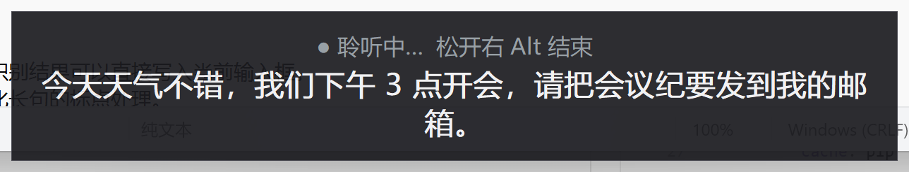
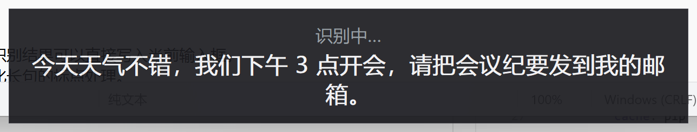
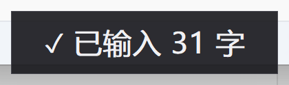
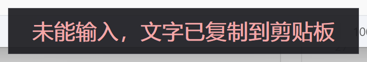
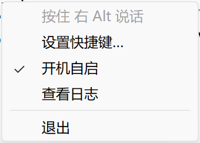

# 豆包语音输入（独立版）

把豆包输入法里的语音转文字能力单独抽出来的 Windows 小工具：按住快捷键说话，松开后文字直接输入到当前光标处，不用切换输入法。

## 功能

- 按住说话、松开输入，`Esc` 取消
- 实时转录浮层，边说边看
- 默认快捷键 `右 Alt`，托盘菜单里可改成任意组合键
- 输入结果校验：文字没进输入框时自动复制到剪贴板，不会丢
- 托盘图标与菜单：设置快捷键、开机自启、查看日志、退出
- 单实例运行，重复启动会提示
- 无控制台窗口，开机自启不打扰
- 绿色单文件，无需安装

## 界面

按住快捷键说话时，屏幕底部浮层实时显示识别文字：



松开按键后等待最终结果：



输入成功：



注入失败时自动把文字放进剪贴板：



托盘右键菜单：



## 使用

1. 从 [Releases](../../releases) 下载 `DoubaoVoice.exe`
2. 双击运行，出现托盘图标即已就绪
3. 在任意输入框里按住 `右 Alt`（或你设置的快捷键）说话，松开后自动输入；按 `Esc` 取消本次录音
4. 右击托盘图标可设置快捷键、开启开机自启、查看日志或退出

语音识别在豆包服务器完成，需要联网。如果听不到声音，检查“设置 → 隐私 → 麦克风”是否允许桌面应用访问麦克风。

## 构建

环境：Windows x64、Python 3.11。

```bat
pip install -r requirements.txt
python -m PyInstaller --noconfirm --clean DoubaoVoice_new.spec
```

产物为 `dist\DoubaoVoice_new.exe`，重命名为 `DoubaoVoice.exe` 即可。推送 `v*` 标签时 GitHub Actions 会自动构建并发布 Release。

## 命令行参数

程序是无控制台的 GUI 程序，参数只在本次启动生效，屏幕上不会有文字输出；识别结果显示在悬浮窗，详细信息写入 exe 同目录的 `voice_ime.log`。

| 参数 | 说明 |
| --- | --- |
| `--device N` | 指定麦克风设备编号，默认用系统默认设备 |
| `--wav FILE` | 用 wav 文件代替麦克风（需 16kHz、单声道、16bit） |
| `--once` | 启动后立即识别一次并退出，必须配合 `--wav` |
| `--inject unicode\|paste` | 文字注入方式：逐字模拟键盘（默认）/ 剪贴板粘贴 |
| `--no-inject` | 只识别不输入 |
| `--no-ui` | 不显示悬浮提示 |
| `--no-tray` | 不显示托盘图标（日常不建议，退出只能靠任务管理器） |
| `--verbose` | 日志记录每个中间识别结果 |

常用示例，在 exe 所在目录执行：

```bat
:: 测试识别：不碰麦克风、不注入，结果看日志
.\DoubaoVoice.exe --once --wav "D:\doubao_work\asr16k.wav" --no-inject --no-ui --no-tray --verbose

:: 指定第 2 个麦克风
.\DoubaoVoice.exe --device 2

:: 某些软件收不到模拟输入时，改用剪贴板粘贴
.\DoubaoVoice.exe --inject paste

:: 只识别不输入，悬浮窗显示识别结果
.\DoubaoVoice.exe --no-inject
```

补充说明：

- 设备编号可以用 `python -c "import sounddevice as sd; print(sd.query_devices())"` 查看，输出每行开头的数字就是编号；启动后日志也会打印实际使用的设备名。
- 带 `--wav` 的测试会跳过单实例检查，正常程序开着也能同时运行。
- 注入失败时（无论哪种注入方式）文字都会自动复制到剪贴板，不会丢。
- 开机自启固定以无参数方式启动。想固定使用某个参数，需要在 `HKCU\Software\Microsoft\Windows\CurrentVersion\Run` 里手动给命令追加参数，或做一个带参数的快捷方式。
- PowerShell 启动 GUI 程序不会等待结束；需要等待时可使用 `Start-Process -FilePath .\DoubaoVoice.exe -ArgumentList '...' -Wait`，Git Bash 中直接运行会等待。

## 目录结构

```
app/voice_ime.py      主程序（键盘钩子、录音、ASR、文字注入、托盘、开机自启）
app/dll/              豆包 SAMI Core SDK
app/icon.ico          程序与托盘图标
DoubaoVoice_new.spec  PyInstaller 打包配置
tools/                逆向分析辅助脚本
```

运行日志和配置保存在 exe 同目录：`voice_ime.log`、`config.json`。

## 注意

- 非豆包官方项目。语音识别调用豆包输入法内置的 SDK 与凭据，账号与数据使用受豆包服务条款约束。
- 仅供个人学习使用，请勿分发 `app/dll` 下的 SDK 文件。
- 快捷键没反应时先看托盘菜单的“查看日志”，常见原因是组合键被其他软件占用。
